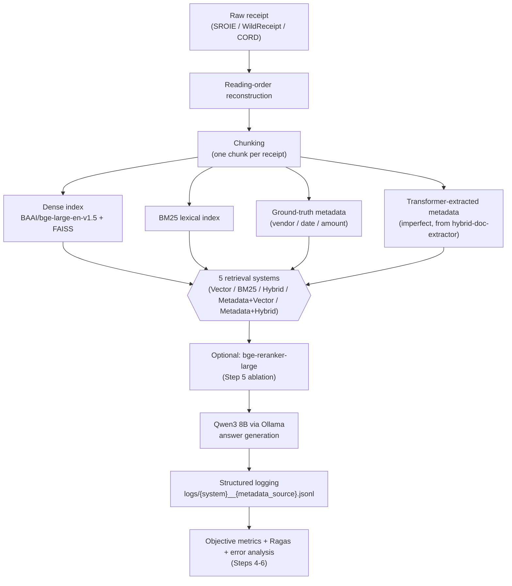
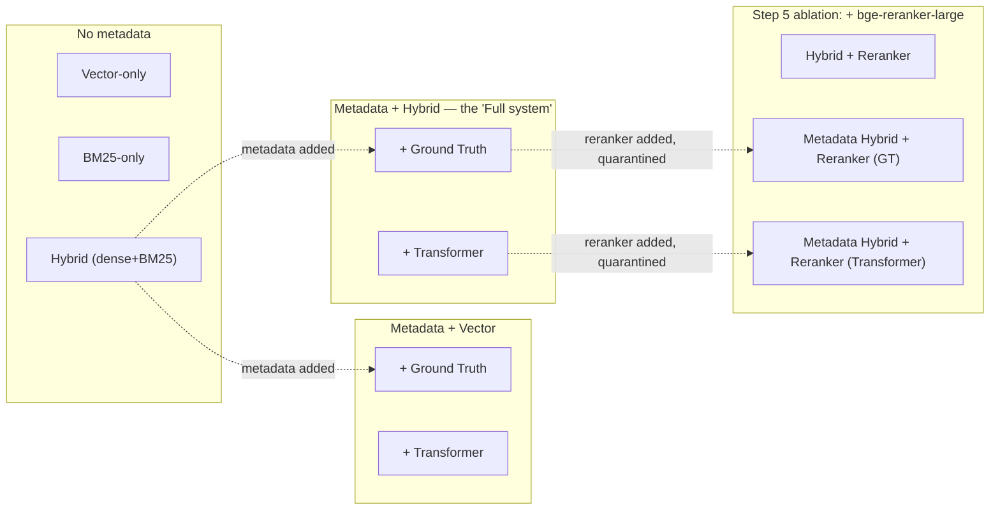

# Enterprise Document Intelligence RAG

Does structured metadata extracted from business documents actually improve RAG retrieval — and how much does *imperfect*, model-extracted metadata erode that benefit compared to ground truth? This project builds a full retrieval-augmented question-answering pipeline over three real receipt datasets (SROIE, WildReceipt, CORD — 3,712 documents), runs a controlled 5×2 experiment matrix (5 retrieval strategies × 2 metadata sources), and reports the results honestly, including the ones that didn't come out clean.

**Novel contribution:** the metadata-quality linkage table — correlating upstream extraction F1 (from a previously trained Transformer model) against downstream retrieval Recall@10. This connects this project to its predecessor (`hybrid-doc-extractor`, the model that produces the "imperfect" metadata) into one coherent two-part story.

> This README is the 10-minute version. For the full step-by-step build history, every bug found and fixed, and the complete evidence behind every claim below, see [`PROJECT_GRAPH_REPORT.md`](PROJECT_GRAPH_REPORT.md) — the exhaustive technical record.

## Project status

| Steps 0–6 | Step 7 | Step 8 |
|---|---|---|
| ✅ **Complete** — environment, corpus, retrieval, evaluation, reranker ablation, error analysis | ✅ **Complete** — README and research write-up | ⏳ **Not implemented** — see [Next step](#next-step-deployment) |

All results below come from Steps 4–6, already run and verified. **Deployment (a usable web app) does not exist yet** — right now this is a set of scripts you run from a terminal, not a hosted service.

## Quick-start prerequisites

- **OS:** WSL2 or native Linux (developed and tested on WSL2/Ubuntu)
- **Python:** 3.12
- **GPU:** optional — an 8GB-VRAM GPU (developed on an RTX 5060 Laptop) substantially accelerates embedding and reranking; CPU execution is supported but slower
- **Ollama + Qwen3 8B:** required for answer generation and Ragas judging (`ollama pull qwen3:8b`) — everything else (retrieval, objective metrics) works without it
- **Two separate virtual environments** (see [Repository structure](#repository-structure)): an "old" venv (pinned, fragile, extraction-model inference only) and a "new" venv (this repo's actual RAG stack) — they never share dependencies and communicate only by reading/writing plain JSON/JSONL files

## Repository structure

```
document-intelligence-rag/
├── scripts/                    # every pipeline stage — one focused script per concern
│   ├── reconstruct_reading_order.py   # raw OCR boxes -> reading-order text (Step 0)
│   ├── chunk_corpus.py                # unify 3 sources into chunks.jsonl (Step 1)
│   ├── embed_index.py                 # BGE embeddings + FAISS index (Step 1)
│   ├── dense_retrieve.py / bm25_retrieve.py / fusion.py   # retrieval baselines (Steps 1-2)
│   ├── metadata_filter.py             # metadata-aware retrieval wrapper (Step 3)
│   ├── eval_metadata_extraction.py    # per-field extraction accuracy (Step 3)
│   ├── build_eval_queries.py          # the 57-query eval set (Step 4)
│   ├── llm_client.py                  # Qwen3/Ollama wrapper (Step 4)
│   ├── run_eval_matrix.py             # the 7-system evaluation harness (Step 4)
│   ├── compute_objective_metrics.py / run_ragas_eval.py   # scoring (Step 4)
│   ├── rerank.py / run_reranker_ablation.py / score_reranker_ablation.py  # Step 5
│   └── error_analysis.py              # Step 6, reads logs only, no re-running
├── data/                        # gitignored — regenerable from scripts + raw sources
│   ├── chunks/, index/, metadata/, eval/    # every intermediate + final artifact
├── logs/                        # gitignored — one JSONL per system-run, written by QueryLogger
├── PROJECT_GRAPH_REPORT.md      # the exhaustive technical history (every bug, every decision)
└── ENVIRONMENT_NOTES.md         # exact working dependency versions + the fixes that got them there
```

Generated data, indexes, logs, and reports are gitignored and regenerable. Environment-specific exceptions, including the documented Ragas compatibility shim, are described in [`ENVIRONMENT_NOTES.md`](ENVIRONMENT_NOTES.md).

## Pipeline



## Experiment matrix



## Results

### Step 4 — objective metrics (57 queries, 7 systems, no LLM needed)

| System | Hit@10 | MRR |
|---|---|---|
| Vector-only | 0.417 | 0.231 |
| BM25-only | 0.639 | 0.519 |
| Hybrid | 0.556 | 0.385 |
| Metadata + Vector (GT / Transformer) | 0.417 / 0.417 | 0.231 / 0.231 |
| Metadata + Hybrid (GT / Transformer) | 0.556 / 0.556 | 0.385 / 0.385 |

BM25 leading here reflects this query set's heavy weighting toward factual lookups with real lexical anchors (vendor names, dollar amounts) — not a general claim that BM25 beats dense retrieval.

### The metadata-quality linkage table (headline result)

| Metadata Source | Vendor F1 | Date F1 | Amount F1 | Retrieval Recall@10 (filtered queries) |
|---|---|---|---|---|
| Ground Truth | 100% | 100% | 100% | 76.4% |
| Transformer (imperfect) | 87.6% | 90.8% | 61.3% | 76.4% |

Recall@10 is identical despite the Transformer's much lower F1 — investigated, not assumed: 12 of the 14 metadata-filtered test queries produced byte-identical retrieved sets between the two sources, because this slice of the eval sampled high-volume vendors the Transformer happens to extract correctly every time. **This is a real limitation of the current query set, not evidence that metadata quality doesn't matter** — no query in the set filters by `date` or `amount` (the field with the *worst* extraction F1, 61.3%), so the linkage table can only speak to vendor-filter quality. See [Limitations](#limitations).

### Step 5 — reranker ablation

| Variant | Hit@10 | MRR | Filtered Recall@10 | Small-set Recall@10 |
|---|---|---|---|---|
| Hybrid baseline (no reranker) | 0.556 | 0.385 | 0.764 | 0.760 |
| Hybrid + reranker | 0.694 | 0.618 | — (unfiltered) | 0.644 |
| Metadata Hybrid + reranker (GT) | 0.694 | 0.618 | 0.829 | 0.829 |
| Metadata Hybrid + reranker (Transformer) | 0.694 | 0.618 | 0.829 | 0.829 |

**Mixed, honest verdict:** the reranker meaningfully improves single-target Hit@10/MRR and metadata-filtered recall, but *regresses* unfiltered multi-target "show me all receipts from vendor X" queries (76.0%→64.4% recall) — a cross-encoder scores each passage independently and has no notion that same-vendor receipts should cluster together. Step 6's error analysis found this regression all but disappears once a metadata filter pre-narrows the candidate pool first — **metadata filtering appears to protect reranking from this failure mode**, a genuine mechanistic finding, not just two unrelated results.

### Latency trade-offs

| Stage | Typical cost |
|---|---|
| Retrieval (dense/BM25/hybrid) | ~0.02–0.07 s/query |
| Reranking (bge-reranker-large, 50 candidates) | ~3.8–4.7 s/query — the dominant cost, ~2 orders of magnitude over retrieval |
| Answer generation (Qwen3 8B, thinking disabled) | ~4 s/query (thinking *enabled* costs ~55 s/query — always disable it) |

## How the evaluation evidence is tiered

This project intentionally does not treat all evaluation numbers as equally trustworthy:

- **Objective retrieval metrics (Hit@10, MRR, Recall@10, Precision@10) are the primary, fully trustworthy evidence** — they require no LLM judge and answer the research questions directly.
- **Answer Relevancy and Context Precision (Ragas, LLM-judged) are secondary answer-quality evidence** — usable, but judged by a small local model (Qwen3 8B) rather than a frontier model, so treat them as directional, not definitive.
- **Faithfulness and Context Recall were excluded** — the local judge could not reliably produce the structured output these two metrics require (50–90% parse-failure rate even after Ragas's own retry logic), a genuine model-capability limitation, not a bug that was left unfixed.

Objective metrics provide the primary evaluation evidence, while the reliable subset of Ragas metrics provides secondary answer-quality evidence.

## What surprised us

- **BM25 confidently retrieves the wrong topic when literal tokens collide.** Querying "receipt for refueling a car" returned car *washes*, not gas stations — a transaction ID field literally reading `Car#304` lexically matched the query's word "car" despite being semantically unrelated. Dense retrieval got this right with zero keyword overlap.
- **CORD misses 100% of its single-target factual queries.** Those queries have to anchor on a document ID (CORD has no vendor/date fields by design) — an ID carries no natural-language signal for either dense or lexical retrieval to match against.
- **Qwen3's "thinking" mode is a ~13x latency trap.** A trivial factual answer took 55 seconds with thinking enabled, 4 seconds with it explicitly disabled (`think: false` on Ollama's API) — silent unless you measure it directly.
- **A cross-encoder reranker and a metadata filter interact, not just add.** See the Step 5 result above — this wasn't hypothesized going in, it fell out of Step 6's error analysis.

## Limitations

- The metadata-quality linkage table currently only exercises the **vendor** field as a retrieval filter — never `date` or `amount` (the field with the worst extraction F1). The "no separation between Ground Truth and Transformer" finding is a vendor-filter-specific result, not a general one.
- Ragas's Faithfulness and Context Recall metrics are not usable with the current local judge model (see [evaluation tiers](#how-the-evaluation-evidence-is-tiered) above).
- The linkage table's Hybrid/Mamba rows (from the companion extraction project's other trained architectures) haven't been run yet — the checkpoints are confirmed usable, just not yet exercised over this corpus.
- The reranker ablation's "small-set" regression finding is based on a modest number of vendor-cluster queries (14) — real, evidenced with concrete examples, but not a large-sample result.

## Reproducing the results

Two separate virtual environments are involved. **Every command below runs in this repo's own ("new") venv, except one explicit handoff in Step 2** — the Transformer checkpoint inference — which must run in the companion extraction project's ("old") venv, since only that environment has the trained model's dependencies installed. Activate the new venv first:

```bash
cd ~/document-intelligence-rag
source venv/bin/activate
```

### 1. Corpus & index construction (new venv)

```bash
# raw source data lives in the companion extraction project, not this repo —
# this project only imports it as a one-time read (see PROJECT_GRAPH_REPORT.md Section 3)
python scripts/reconstruct_reading_order.py \
    --wildreceipt-dir ~/hybrid-doc-extractor/data/raw/wildreceipt/wildreceipt \
    --sroie-dir ~/hybrid-doc-extractor/data/raw/sroie/SROIE2019

python scripts/chunk_corpus.py

python scripts/embed_index.py
```

### 2. Metadata extraction (dual-track: ground truth is already in chunks.jsonl; Transformer requires the old venv)

```bash
# OLD VENV ONLY — the script lives in the companion extraction project
# (~/hybrid-doc-extractor/scripts/), not in this repo, since it imports that
# project's model/checkpoint code directly. Uses the old venv's own
# interpreter explicitly rather than relying on any activated environment.
# Verified working end-to-end with this exact command before documenting it.
cd ~/hybrid-doc-extractor
venv/bin/python scripts/extract_metadata_transformer.py \
    --old-repo-root ~/hybrid-doc-extractor \
    --chunks ~/document-intelligence-rag/data/chunks/chunks.jsonl \
    --out ~/document-intelligence-rag/data/metadata/transformer_extracted.jsonl \
    --arm transformer \
    --seed 456

# back in this repo, new venv — score extraction accuracy vs. ground truth
cd ~/document-intelligence-rag
python scripts/eval_metadata_extraction.py
```

### 3. Evaluation (Step 4 — core 5×2 matrix, new venv)

```bash
python scripts/build_eval_queries.py

python scripts/run_eval_matrix.py --limit 5   # pilot first
python scripts/run_eval_matrix.py             # full run, all 7 systems

python scripts/compute_objective_metrics.py
python scripts/run_ragas_eval.py --max-workers 2
```

### 4. Reranker ablation (Step 5 — quarantined, additive only, new venv)

```bash
python scripts/rerank.py                          # self-test
python scripts/run_reranker_ablation.py --limit 5 # pilot first
python scripts/run_reranker_ablation.py           # full run
python scripts/score_reranker_ablation.py
```

### 5. Error analysis (Step 6 — reads logs only, makes no new calls, new venv)

```bash
python scripts/error_analysis.py            # prints for spot-check
python scripts/error_analysis.py --write    # writes data/eval/error_analysis_report.json
```

## Next step: deployment

**Not implemented yet.** Step 8 will wrap the best-performing pipeline (not every experimental variant) behind FastAPI (the backend engine), a Gradio interface (the actual page a person types into), and a Cloudflare Tunnel (temporary public URL, no hosting cost) — deliberately last, so nothing gets packaged and shared before the real results above were locked in.
