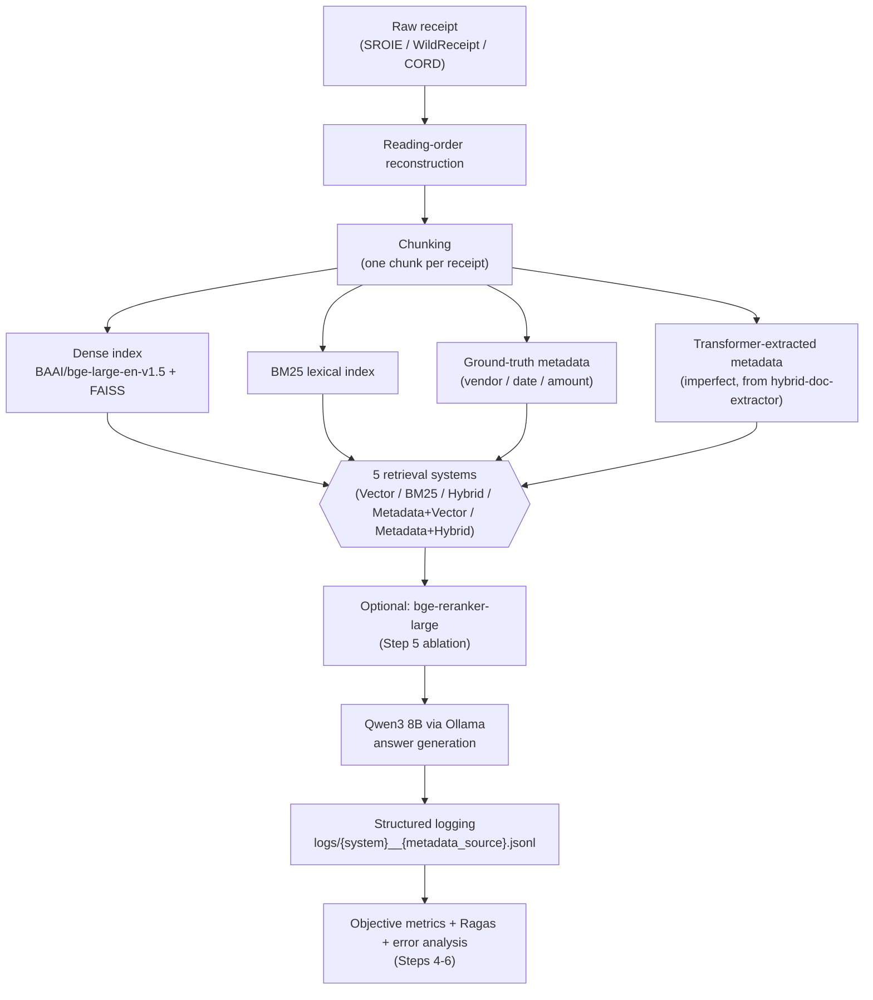
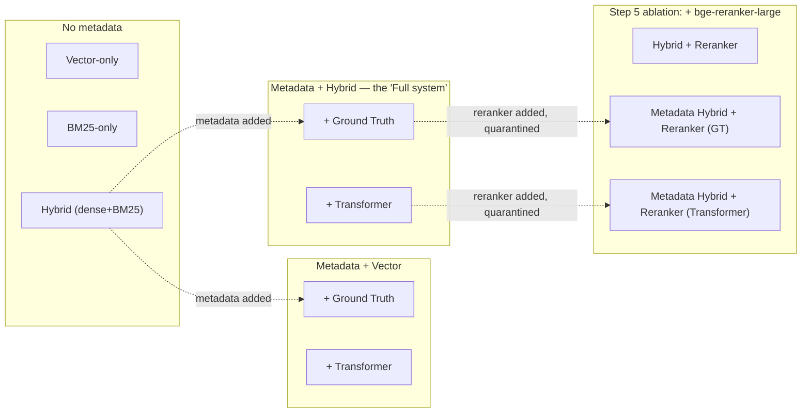

# Enterprise Document Intelligence RAG

> **Learning guide:** for a from-evidence technical walkthrough of this
> entire project — research and application, architecture, bugs and fixes,
> testing, configuration, and real deployment status — see
> [`docs/learning/INDEX.md`](docs/learning/INDEX.md).

Does structured metadata extracted from business documents actually improve RAG retrieval — and how much does *imperfect*, model-extracted metadata erode that benefit compared to ground truth? This project builds a full retrieval-augmented question-answering pipeline over three real receipt datasets (SROIE, WildReceipt, CORD — 3,712 documents), runs a controlled 5×2 experiment matrix (5 retrieval strategies × 2 metadata sources), and reports the results honestly, including the ones that didn't come out clean.

**Novel contribution:** the metadata-quality linkage table — correlating upstream extraction F1 (from a previously trained Transformer model) against downstream retrieval Recall@10. This connects this project to its predecessor (`hybrid-doc-extractor`, the model that produces the "imperfect" metadata) into one coherent two-part story.

> This README is the 10-minute version. For the full step-by-step build history, every bug found and fixed, and the complete evidence behind every claim below, see [`PROJECT_GRAPH_REPORT.md`](PROJECT_GRAPH_REPORT.md) — the exhaustive technical record.

## Project status

| Steps 0–6 | Step 7 | Step 8 |
|---|---|---|
| **Complete** — environment, corpus, retrieval, evaluation, reranker ablation, error analysis | **Complete** — README and research write-up | **Local application and LangGraph agent: implemented and tested. Public hosting: deferred (cost) — see [Next step](#next-step-deployment)** |

All results below come from Steps 4–6, already run and verified. This research corpus/pipeline is never served publicly — the demo application below wraps a separate, synthetic demo corpus instead.

## Try the local demo

This is the deployable application built on top of the research above: a FastAPI backend with a hand-built web frontend, a Standard RAG workflow and a LangGraph agent workflow, receipt upload with OCR, and answer generation via Together.ai's hosted API. **This is a local demo you run yourself, not a public website** — see [Next step: deployment](#next-step-deployment) for why.

### What it does

Ask questions about receipts — either the synthetic sample receipts bundled with the repo, or ones you upload yourself (JPG/PNG/PDF) — and get grounded answers with citations back to the specific receipt text that supports them. Two answering modes are available side by side: a direct retrieve-then-generate pipeline (Standard RAG), and a LangGraph agent that searches, fetches, and assesses evidence itself, can ask a clarifying question if your question is ambiguous between several receipts, and verifies its own cited evidence is actually present in the retrieved text before answering.

### Prerequisites

- **Git**
- **Docker** (tested with Docker Desktop's WSL2 integration on Ubuntu, and with Docker directly on Linux)
- **A Together.ai account and API key** — required for generated answers. Create an account at [together.ai](https://together.ai), add a small prepaid balance (check their current pricing before adding funds), and generate a key at [api.together.ai/settings/api-keys](https://api.together.ai/settings/api-keys). There is no free tier for this step; using your own key means you are responsible for your own usage cost (see [Privacy and cost](#privacy-and-cost) below).

### Clone, configure, build, run

```bash
git clone https://github.com/JoshuvaPrabhakarP/Document-Intelligence-RAG.git
cd Document-Intelligence-RAG
cp .env.example .env
```

Now open `.env` and set `GENERATION_API_KEY` to your own Together.ai key (replace the `your-together-ai-api-key-here` placeholder). Nothing else in `.env` needs to change for the demo to work.

```bash
docker build -t doc-rag .
docker run -d --name doc-rag-demo -p 127.0.0.1:8000:8000 --env-file .env doc-rag
```

**Local demo: [http://127.0.0.1:8000](http://127.0.0.1:8000)** — open that URL in a browser once the container is running.

The port is bound to `127.0.0.1` only (not `0.0.0.0`) deliberately, so the demo is reachable from your own machine only, not your local network — matching the "local demo, not a public deployment" scope above. This is the one command sequence that's actually needed; there is no single command that also handles creating your `.env` or pasting in your own API key for you, since those are things only you can do.

### Using it

The page has two tabs: **Try Sample Receipts** (the bundled synthetic demo corpus) and **Upload Your Documents** (your own JPG/PNG/PDF, OCR'd locally with Tesseract — no third-party OCR service, though see the privacy note below for what happens once you *ask a question* about what you uploaded). A toggle switches between the Standard RAG and Agent workflows; the Agent is the default, since it's the better-verified of the two (see `PROGRESS.md` for why).

Sample questions that work against the bundled demo corpus (also shown as clickable chips in the UI):
- "What is the total amount on the Example Grocers Inc. receipt?"
- "Which vendor issued a receipt for $156.42?"
- "What date is on the Sample Coffee Co. receipt?"
- "What is the total at Sample Gas Station?"

To try your own receipt: switch to the **Upload Your Documents** tab, drag in a JPG/PNG/PDF (up to 10MB, up to 20 pages), then ask a question about it once it's processed.

### Expected startup time and resource requirements

- **Build**: around 15–20 minutes the first time (downloads and bakes in ~3.5GB of embedding/reranker model weights so the running container never needs network access to Hugging Face). Rebuilding after an app-code-only change is a few seconds (cached layers).
- **Container startup**: `/health` responds in roughly 2–3 seconds. Models load lazily on first use, not at startup.
- **First question**: can take anywhere from about 10 to 45 seconds — this is the one-time cost of loading the embedding/reranker models into memory, combined with ordinary real-API response-time variance from Together.ai. Verified directly: one cold run took 43 seconds, a second (warm) run of the same question took 8.5 seconds.
- **Every question after that**: single-digit seconds typically.
- **Memory**: give Docker at least 2GB of RAM. Measured peak usage has ranged from about 1.2GB to 2.6GB depending on which workflows get exercised and how memory is measured (`docker stats` vs. raw process RSS give different numbers for the same run — see `PROGRESS.md` for the full measurement detail, not reconciled into a single number here since the discrepancy itself wasn't resolved).

### Limitations

- This is a demo over a small synthetic receipt corpus (about a dozen fabricated receipts), not a production document-intelligence system — it has not been evaluated with the same rigor as the research corpus (see `PROGRESS.md`'s evaluation sections for what *has* been rigorously measured, which is the research pipeline, not this demo corpus).
- The Agent workflow occasionally makes a wrong routing or answer choice on a real model call — this is measured, real-model sampling variance (see `PROGRESS.md`), not something this demo can guarantee against. Asking again usually resolves it.
- Standard RAG's ambiguous-question clarification is known to be less reliable than the Agent's (a documented, structural limitation of its free-text output format) — prefer the Agent workflow if a question could match more than one receipt.
- Uploaded files and any in-progress clarification are stored only in memory/temp storage for the running container and are lost if the container restarts — there is no persistent storage.

### Stopping, restarting, and troubleshooting

```bash
docker stop doc-rag-demo      # stop the container (uploads/sessions are lost)
docker start doc-rag-demo     # restart it (same image, no rebuild needed)
docker logs doc-rag-demo      # see what the app is doing / why something failed
docker rm -f doc-rag-demo     # remove the container entirely
```

| Symptom | Likely cause | Fix |
|---|---|---|
| `docker build` fails on the model-download step | No network access during build, or Hugging Face Hub temporarily unreachable | Retry the build — it needs network access once, at build time only |
| `curl http://127.0.0.1:8000/ready` shows `"generation_provider_reachable": false` | `GENERATION_API_KEY` in `.env` is still the placeholder, wrong, or out of prepaid balance | Check `.env`, confirm the key at [api.together.ai/settings/api-keys](https://api.together.ai/settings/api-keys), confirm balance |
| Browser can't reach `127.0.0.1:8000` | Container isn't running, or the port mapping was typed differently | `docker ps` to check it's `Up`; re-check the `-p 127.0.0.1:8000:8000` flag matches exactly |
| A question about an uploaded file returns nothing relevant | OCR may have failed to extract text from a low-quality scan, or the file wasn't finished processing yet | Check the extracted-text panel in the UI after upload; re-upload a clearer image if needed |
| Everything was working, now queries return `503` | The app's own per-IP/global rate limits were hit (by design, see `app/ratelimit.py`) | Wait a minute and retry |

### Privacy and cost

**Relevant excerpts from documents you ask about — the sample receipts or anything you upload — are sent to Together.ai's hosted API to generate the answer.** This is true for both workflows. Don't upload or ask about anything you don't want leaving your machine. Generating answers through your own Together.ai API key uses your own prepaid balance and **may cost you real money** — this project measured roughly $0.0001–0.001 per question in its own testing (see `PROGRESS.md` for the exact measured figures and methodology), but costs can vary with question complexity and Together's current pricing; check your own balance and Together's current rates rather than relying on this estimate.

## Quick-start prerequisites

- **OS:** WSL2 or native Linux (developed and tested on WSL2/Ubuntu)
- **Python:** 3.12
- **GPU:** optional — an 8GB-VRAM GPU (developed on an RTX 5060 Laptop) substantially accelerates embedding and reranking; CPU execution is supported but slower
- **Ollama + Qwen3 8B:** required for answer generation and Ragas judging (`ollama pull qwen3:8b`) — everything else (retrieval, objective metrics) works without it
- **Two separate virtual environments** (see [Repository structure](#repository-structure)): an "old" venv (pinned, fragile, extraction-model inference only) and a "new" venv (this repo's actual RAG stack) — they never share dependencies and communicate only by reading/writing plain JSON/JSONL files

## Repository structure

```
document-intelligence-rag/
├── scripts/                    # every pipeline stage — one focused script per concern
│   ├── reconstruct_reading_order.py   # raw OCR boxes -> reading-order text (Step 0)
│   ├── chunk_corpus.py                # unify 3 sources into chunks.jsonl (Step 1)
│   ├── embed_index.py                 # BGE embeddings + FAISS index (Step 1)
│   ├── dense_retrieve.py / bm25_retrieve.py / fusion.py   # retrieval baselines (Steps 1-2)
│   ├── metadata_filter.py             # metadata-aware retrieval wrapper (Step 3)
│   ├── eval_metadata_extraction.py    # per-field extraction accuracy (Step 3)
│   ├── build_eval_queries.py          # the 57-query eval set (Step 4)
│   ├── llm_client.py                  # Qwen3/Ollama wrapper (Step 4)
│   ├── run_eval_matrix.py             # the 7-system evaluation harness (Step 4)
│   ├── compute_objective_metrics.py / run_ragas_eval.py   # scoring (Step 4)
│   ├── rerank.py / run_reranker_ablation.py / score_reranker_ablation.py  # Step 5
│   └── error_analysis.py              # Step 6, reads logs only, no re-running
├── data/                        # gitignored — regenerable from scripts + raw sources
│   ├── chunks/, index/, metadata/, eval/    # every intermediate + final artifact
├── logs/                        # gitignored — one JSONL per system-run, written by QueryLogger
├── PROJECT_GRAPH_REPORT.md      # the exhaustive technical history (every bug, every decision)
└── ENVIRONMENT_NOTES.md         # exact working dependency versions + the fixes that got them there
```

Generated data, indexes, logs, and reports are gitignored and regenerable. Environment-specific exceptions, including the documented Ragas compatibility shim, are described in [`ENVIRONMENT_NOTES.md`](ENVIRONMENT_NOTES.md).

## Pipeline



## Experiment matrix



## Results

### Step 4 — objective metrics (57 queries, 7 systems, no LLM needed)

| System | Hit@10 | MRR |
|---|---|---|
| Vector-only | 0.417 | 0.231 |
| BM25-only | 0.639 | 0.519 |
| Hybrid | 0.556 | 0.385 |
| Metadata + Vector (GT / Transformer) | 0.417 / 0.417 | 0.231 / 0.231 |
| Metadata + Hybrid (GT / Transformer) | 0.556 / 0.556 | 0.385 / 0.385 |

BM25 leading here reflects this query set's heavy weighting toward factual lookups with real lexical anchors (vendor names, dollar amounts) — not a general claim that BM25 beats dense retrieval.

### The metadata-quality linkage table (headline result)

| Metadata Source | Vendor F1 | Date F1 | Amount F1 | Retrieval Recall@10 (filtered queries) |
|---|---|---|---|---|
| Ground Truth | 100% | 100% | 100% | 76.4% |
| Transformer (imperfect) | 87.6% | 90.8% | 61.3% | 76.4% |

Recall@10 is identical despite the Transformer's much lower F1 — investigated, not assumed: 12 of the 14 metadata-filtered test queries produced byte-identical retrieved sets between the two sources, because this slice of the eval sampled high-volume vendors the Transformer happens to extract correctly every time. **This is a real limitation of the current query set, not evidence that metadata quality doesn't matter** — no query in the set filters by `date` or `amount` (the field with the *worst* extraction F1, 61.3%), so the linkage table can only speak to vendor-filter quality. See [Limitations](#limitations).

### Step 5 — reranker ablation

| Variant | Hit@10 | MRR | Filtered Recall@10 | Small-set Recall@10 |
|---|---|---|---|---|
| Hybrid baseline (no reranker) | 0.556 | 0.385 | 0.764 | 0.760 |
| Hybrid + reranker | 0.694 | 0.618 | — (unfiltered) | 0.644 |
| Metadata Hybrid + reranker (GT) | 0.694 | 0.618 | 0.829 | 0.829 |
| Metadata Hybrid + reranker (Transformer) | 0.694 | 0.618 | 0.829 | 0.829 |

**Mixed, honest verdict:** the reranker meaningfully improves single-target Hit@10/MRR and metadata-filtered recall, but *regresses* unfiltered multi-target "show me all receipts from vendor X" queries (76.0%→64.4% recall) — a cross-encoder scores each passage independently and has no notion that same-vendor receipts should cluster together. Step 6's error analysis found this regression all but disappears once a metadata filter pre-narrows the candidate pool first — **metadata filtering appears to protect reranking from this failure mode**, a genuine mechanistic finding, not just two unrelated results.

### Latency trade-offs

| Stage | Typical cost |
|---|---|
| Retrieval (dense/BM25/hybrid) | ~0.02–0.07 s/query |
| Reranking (bge-reranker-large, 50 candidates) | ~3.8–4.7 s/query — the dominant cost, ~2 orders of magnitude over retrieval |
| Answer generation (Qwen3 8B, thinking disabled) | ~4 s/query (thinking *enabled* costs ~55 s/query — always disable it) |

## How the evaluation evidence is tiered

This project intentionally does not treat all evaluation numbers as equally trustworthy:

- **Objective retrieval metrics (Hit@10, MRR, Recall@10, Precision@10) are the primary, fully trustworthy evidence** — they require no LLM judge and answer the research questions directly.
- **Answer Relevancy and Context Precision (Ragas, LLM-judged) are secondary answer-quality evidence** — usable, but judged by a small local model (Qwen3 8B) rather than a frontier model, so treat them as directional, not definitive.
- **Faithfulness and Context Recall were excluded** — the local judge could not reliably produce the structured output these two metrics require (50–90% parse-failure rate even after Ragas's own retry logic), a genuine model-capability limitation, not a bug that was left unfixed.

Objective metrics provide the primary evaluation evidence, while the reliable subset of Ragas metrics provides secondary answer-quality evidence.

## What surprised us

- **BM25 confidently retrieves the wrong topic when literal tokens collide.** Querying "receipt for refueling a car" returned car *washes*, not gas stations — a transaction ID field literally reading `Car#304` lexically matched the query's word "car" despite being semantically unrelated. Dense retrieval got this right with zero keyword overlap.
- **CORD misses 100% of its single-target factual queries.** Those queries have to anchor on a document ID (CORD has no vendor/date fields by design) — an ID carries no natural-language signal for either dense or lexical retrieval to match against.
- **Qwen3's "thinking" mode is a ~13x latency trap.** A trivial factual answer took 55 seconds with thinking enabled, 4 seconds with it explicitly disabled (`think: false` on Ollama's API) — silent unless you measure it directly.
- **A cross-encoder reranker and a metadata filter interact, not just add.** See the Step 5 result above — this wasn't hypothesized going in, it fell out of Step 6's error analysis.

## Limitations

- The metadata-quality linkage table currently only exercises the **vendor** field as a retrieval filter — never `date` or `amount` (the field with the worst extraction F1). The "no separation between Ground Truth and Transformer" finding is a vendor-filter-specific result, not a general one.
- Ragas's Faithfulness and Context Recall metrics are not usable with the current local judge model (see [evaluation tiers](#how-the-evaluation-evidence-is-tiered) above).
- The linkage table's Hybrid/Mamba rows (from the companion extraction project's other trained architectures) haven't been run yet — the checkpoints are confirmed usable, just not yet exercised over this corpus.
- The reranker ablation's "small-set" regression finding is based on a modest number of vendor-cluster queries (14) — real, evidenced with concrete examples, but not a large-sample result.

## Reproducing the results

Two separate virtual environments are involved. **Every command below runs in this repo's own ("new") venv, except one explicit handoff in Step 2** — the Transformer checkpoint inference — which must run in the companion extraction project's ("old") venv, since only that environment has the trained model's dependencies installed. Activate the new venv first:

```bash
cd ~/document-intelligence-rag
source venv/bin/activate
```

### 1. Corpus & index construction (new venv)

```bash
# raw source data lives in the companion extraction project, not this repo —
# this project only imports it as a one-time read (see PROJECT_GRAPH_REPORT.md Section 3)
python scripts/reconstruct_reading_order.py \
    --wildreceipt-dir ~/hybrid-doc-extractor/data/raw/wildreceipt/wildreceipt \
    --sroie-dir ~/hybrid-doc-extractor/data/raw/sroie/SROIE2019

python scripts/chunk_corpus.py

python scripts/embed_index.py
```

### 2. Metadata extraction (dual-track: ground truth is already in chunks.jsonl; Transformer requires the old venv)

```bash
# OLD VENV ONLY — the script lives in the companion extraction project
# (~/hybrid-doc-extractor/scripts/), not in this repo, since it imports that
# project's model/checkpoint code directly. Uses the old venv's own
# interpreter explicitly rather than relying on any activated environment.
# Verified working end-to-end with this exact command before documenting it.
cd ~/hybrid-doc-extractor
venv/bin/python scripts/extract_metadata_transformer.py \
    --old-repo-root ~/hybrid-doc-extractor \
    --chunks ~/document-intelligence-rag/data/chunks/chunks.jsonl \
    --out ~/document-intelligence-rag/data/metadata/transformer_extracted.jsonl \
    --arm transformer \
    --seed 456

# back in this repo, new venv — score extraction accuracy vs. ground truth
cd ~/document-intelligence-rag
python scripts/eval_metadata_extraction.py
```

### 3. Evaluation (Step 4 — core 5×2 matrix, new venv)

```bash
python scripts/build_eval_queries.py

python scripts/run_eval_matrix.py --limit 5   # pilot first
python scripts/run_eval_matrix.py             # full run, all 7 systems

python scripts/compute_objective_metrics.py
python scripts/run_ragas_eval.py --max-workers 2
```

### 4. Reranker ablation (Step 5 — quarantined, additive only, new venv)

```bash
python scripts/rerank.py                          # self-test
python scripts/run_reranker_ablation.py --limit 5 # pilot first
python scripts/run_reranker_ablation.py           # full run
python scripts/score_reranker_ablation.py
```

### 5. Error analysis (Step 6 — reads logs only, makes no new calls, new venv)

```bash
python scripts/error_analysis.py            # prints for spot-check
python scripts/error_analysis.py --write    # writes data/eval/error_analysis_report.json
```

## Next step: deployment

What was actually built, tracked in `PROGRESS.md` (the authoritative, currently-updated status for this part of the project): a FastAPI backend with a hand-built web frontend (not Gradio), a synthetic public-safe demo corpus kept separate from this research corpus, an upload/OCR feature, a LangGraph agentic workflow alongside the Standard RAG baseline, and Milestone 5's deployment packaging (Docker image, CI, rate limits, a Google Cloud Run deployment plan, and a since-blocked Hugging Face Spaces attempt — see `PROGRESS.md` for what happened there).

**Current, honest status**: the local application and the LangGraph agent are implemented and tested — see [Try the local demo](#try-the-local-demo) above, which you can run yourself right now. **Public hosting has been deferred, explicitly because of its ongoing cost**, not attempted and abandoned as broken. The project's original completion criterion for this part of the work (tracked elsewhere as "Gap 1") was a public HTTPS deployment that works independently of any one computer being on — a local Docker demo does not satisfy that criterion, and a tunnel to a local machine was already explicitly ruled out as satisfying it either, for the same reason. **Running this locally is not a public deployment, and is not described as one anywhere in this project's documentation.** That gap remains open. The deployment files in this repo (`Dockerfile`, `.github/workflows/tests.yml`, the Google Cloud Run plan in `PROGRESS.md`) are kept as-is, ready to use whenever public hosting is pursued — deferring the decision to host publicly is not a decision to remove the capability to do so. See `PROGRESS.md` for the exact current status, every command run so far, and what public hosting would still require.
